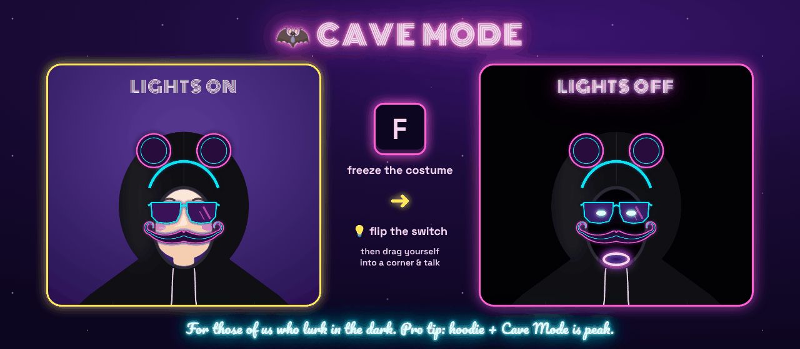
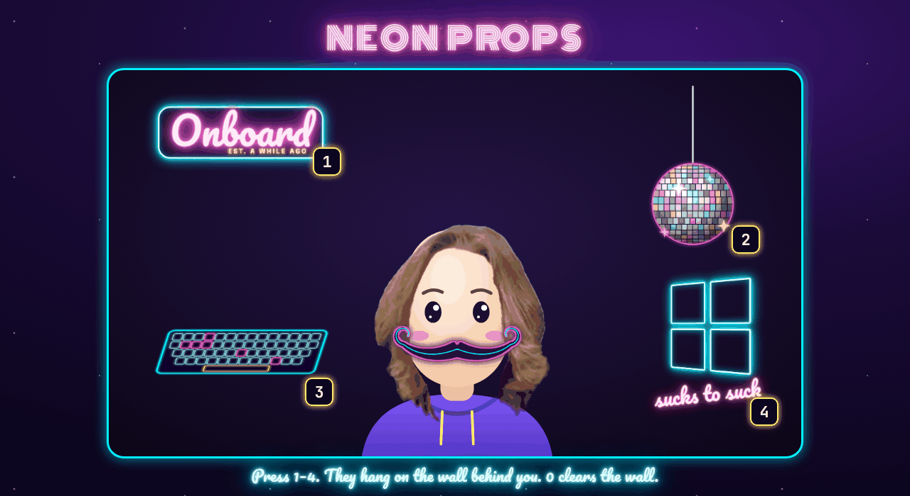
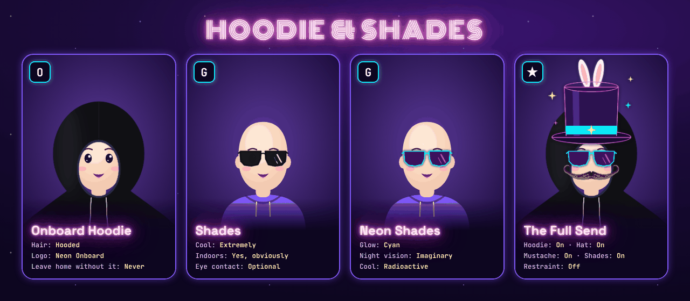
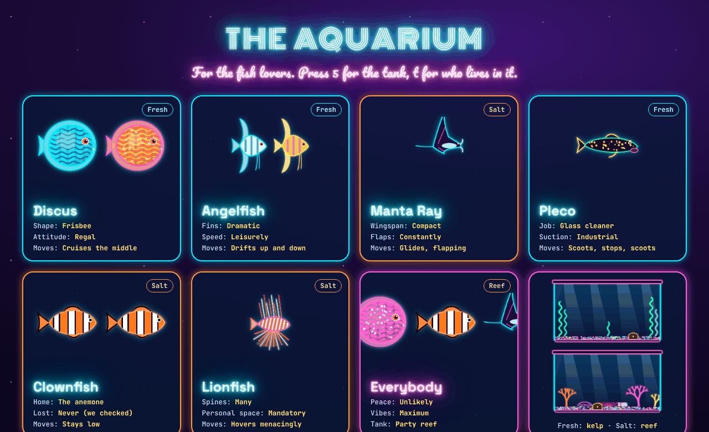
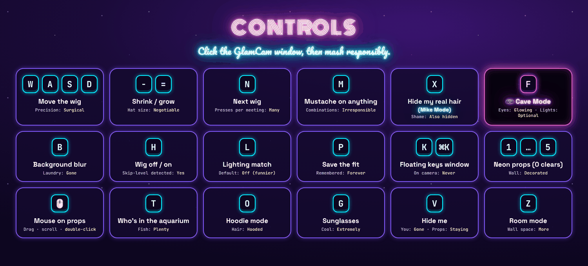
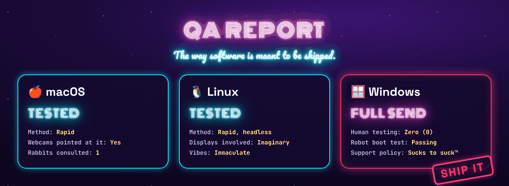

<p align="center">
  
</p>

<p align="center">
  <b>A face-tracking wig for your webcam.</b><br>
  For meetings that could have been an email, but now have <i>hair</i>.
</p>

<p align="center">
  
  
  
  
  
</p>

---

## What is this?

You know that one coworker with *the hair*? Flowing. Luminous. Shampoo-commercial-in-slow-motion hair?

**GlamCam lets you wear it to standup.**

It finds your face 30 times a second, glues a wig to your forehead (it follows you when you lean, tilt, nod, or dramatically turn away from a bad idea), blurs the pile of laundry behind you, and pipes the whole thing into Google Meet, Zoom, or Teams as a normal-looking camera.

Ships with **Glaaron**, the hair that started it all, a **neon magician's top hat** (with rabbit), **two sweet, sweet mustaches**, **The Ultimate Glaaron** (hair + hat + mustache), **Jeff Mode** (Jeff Ears, classic and neon), **sunglasses**, a **hoodie** with a neon Onboard logo, and four neon wigs nobody asked for. Or [make your own](#-make-your-own-wig) from any photo.

| | |
|---|---|
| **Glossiness** | Very |
| **Latency** | Smaller than your attention span in a 9am |
| **HR approved** | Pending |
| **Real hair harmed** | 0 |

## How it works

<p align="center"></p>

1. **MediaPipe** puts 478 dots on your face. GlamCam only listens to the forehead, brows, eyes and temples, so the wig doesn't flap when you talk.
2. The wig gets moved, scaled and rotated to match those dots, every frame.
3. A second model figures out which pixels are *you* and blurs everything else.
4. The result goes out through the **OBS Virtual Camera**, which every video app already knows how to use, either straight from GlamCam or via an OBS scene.

## The Wig Closet

<p align="center"></p>

| Wig | `--wig` | Vibe |
|---|---|---|
| Glaaron | `glaaron` | The original. The legend. Default. |
| Top Hat | `top-hat` | A neon magician's top hat. There is a rabbit. Company-event approved. |
| Glaaron Magnifique | `glaaron-magnifique` | Glaaron, but wearing the top hat. Black tie optional, hair mandatory. |
| The Ultimate Glaaron | `ultimate-glaaron` | Hair. Hat. Mustache. There is nothing left to add. |
| The Mustache | `mustache` | A luxurious brown handlebar, waxed and twirled. Soup risk: high. |
| Neon Mustache | `neon-mustache` | The same handlebar, bent out of glowing glass tubing. Visible from space. |
| Jeff Ears | `jeff-ears` | **Jeff Mode.** Classic round black ears on a headband. |
| Neon Jeff Ears | `neon-jeff-ears` | Jeff Mode, plugged in. Parade ready. |
| Shades | `shades` | Black sunglasses. Also a layer: press `g` to wear them over *any* wig. |
| Neon Shades | `neon-shades` | Cyan neon frames. Night vision: imaginary. Also a `g` layer. |
| Hoodie | `hoodie` | Black athletic hoodie with a deep hood that covers hair and ears, neon Onboard logo on the chest. Also a layer: press `o` to wear it under *any* wig. |
| Disco Inferno | `disco-inferno` | Has a comb in it. The comb lives there now. |
| Synthwave Mullet | `synthwave-mullet` | Business in the front, Miami Vice in the back. |
| Cyber Mohawk | `cyber-mohawk` | Do not attempt doorways. |
| The Executive | `the-executive` | Nine hairs. One dream. |

Press **`n`** while it's running to cycle through them, in this order: from Glaaron, one press gets you the top hat and three get you The Ultimate Glaaron.

> 🥸 **Mustache tip:** press `m` to add a mustache to *whatever* you're wearing. Mustaches are pinned to your upper face like the wigs, so they don't flap when you talk. If one sits a bit high or low on your lip, pick it as the main wig with `n`, nudge it with `w`/`s`, and press `p` to save.
>
> 🦇 **[Cave Mode](#-cave-mode):** get your costume lined up, press `f` to freeze it, then kill the lights. Your Jeff Ears (or Glaaron) keep floating in the dark.

> 🎩 **Tall hat tip:** the top hat (and the mohawk) go well above your head. If the top gets cut off, sit a little further back or press `-` to shrink it, then `p` to save.

---

## ✨ Features

Every feature is one key away. Click the GlamCam window and go.

| Feature | Key | Stats |
|---|---|---|
| 🎩 **Face-tracking costumes**: wigs, hats, mustaches and ears that follow you as you lean, tilt and nod | `n` | Accuracy: **Uncanny** · Looks: **15 and counting** |
| 🥸 **Mustache mix & match**: put a mustache on *any* wig | `m` | Combinations: **Irresponsible** |
| 🥷 **[Hoodie mode](#-hoodie--shades)**: a black hoodie with a neon Onboard logo, under *any* wig | `o` | Hair: **Hooded** |
| 😎 **[Sunglasses](#-hoodie--shades)**: shades or neon shades, over *any* wig | `g` | Cool: **Extremely** |
| 🫥 **Hair hider (Mike Mode)**: paints your real hair out so it can't sneak out from under the wig | `x` | Hair: **Hidden** · Shame: **Also hidden** |
| 🦇 **[Cave Mode](#-cave-mode)**: freeze the costume, kill the lights, lurk with glowing neon-blue eyes and a neon mouth that talks | `f` | Lights: **Optional** · Mouth: **Running** |
| 🪩 **[Neon props](#-neon-props)**: an Onboard sign, a disco ball, a floating neon keyboard and a "sucks to suck" window, hung on the wall *behind* you | `1`–`4` | Wall: **Decorated** |
| 🐠 **[The Aquarium](#-the-aquarium)**: a big neon tank of swimming fish behind you. Pick who lives in it | `5`, then `t` | Fish: **Plenty** |
| 🫥 **Hide me**: removes *you*, blacks out the room, and leaves just your props | `v` | You: **Gone** · Props: **Staying** |
| 🔭 **Room mode**: zooms the camera out so there's more wall for props | `z` | Wall space: **More** |
| 📺 **1080p** out of the box, even if your webcam is 720p | | Pixels: **All of them** |
| 🌫️ **Background blur**: your laundry pile, gone | `b` | Laundry: **Gone** |
| 💡 **Lighting match**: dim a wig to match your room | `l` | Default: **Off, because funnier** |
| 🧪 **[Make your own wig](#-make-your-own-wig)**: any photo, any hair | `--make-wig` | Kevins: **Unlimited** |
| ⌨️ **Floating keys window**: every shortcut, never on camera | `k` / `⌘K` | On camera: **Never** |
| 📺 **Works with** Google Meet, Zoom, Teams and OBS, via the OBS Virtual Camera | | Compatibility: **Suspiciously good** |

## 🦇 Cave Mode

<p align="center"></p>

For those of us who like to lurk in the dark.

1. Get your costume lined up while your lights are on.
2. Press **`f`**. The costume freezes exactly where it is.
3. Turn your lights off. Your face fades into the void; your Jeff Ears, Glaaron hair or neon mustache stay floating right where your head was.
4. As the room goes dark, **two neon-blue eyes** fade in where yours were. They blink every few seconds. Nobody asked for this. Everybody needed it.
5. A **neon mouth** fades in too, and **it talks when you talk**: it listens to your microphone, so it works in total darkness (when there's enough light it follows your actual lips). Quiet: a neon smile. Talking: it opens. Yelling: tongue.
6. **Drag the frozen costume** anywhere in the GlamCam window (scroll over it, or `[` `]`, to resize). Park your glowing self in the bottom corner and give the props the whole wall.
7. Press **`f`** again to come back to the land of the face-tracked.

The mouth needs microphone access. The first time, your Mac asks whether Terminal (or GlamCam) may use the microphone. GlamCam only listens for *how loud* you are; nothing is recorded or sent anywhere. No mic? The mouth still follows your lips whenever there's a little light on your face.

Cave Mode keeps the costume's lighting from the moment you froze it, so it stays bright while you go dark. Neon wigs and props look especially haunted.

> 🥷 **Pro tip:** Cave Mode + [hoodie](#-hoodie--shades) + Neon Jeff Ears + neon shades + neon mustache is, scientifically speaking, peak.

## 🪩 Neon Props

<p align="center"></p>

Decorate the wall behind you. Press a number to toggle a prop, **`0`** to clear the wall. (Prop **`5`** is the [Aquarium](#-the-aquarium), which gets its own section, because fish.)

| Key | Prop | Stats |
|---|---|---|
| `1` | **Onboard sign**: our first name, in pink neon, flickering like a real sign | Est.: **A while ago** |
| `2` | **Disco ball**: hanging from the ceiling, top middle, sparkling | Groove: **Permanent** |
| `3` | **Floating neon keyboard**: gently bobbing in mid-air | Keys pressed: **None, it floats** |
| `4` | **Sucks to suck**: a neon four-pane window, our [Windows support policy](#-qa-policy) made visible | Sympathy: **None** |

Props hang *behind* you: GlamCam already knows which pixels are you (the same trick the background blur uses), so it draws props only on the background and you stay in front. Walk in front of the disco ball and it disappears behind your head, like a real one. In the dark with Cave Mode they keep glowing.

**Put them wherever you want.** Every prop starts in a default spot, and then it's yours to arrange:

| Do this (in the GlamCam window) | To |
|---|---|
| 🖱️ **Click and drag** a prop | Move it anywhere |
| 🖱️ **Scroll** over a prop | Shrink or grow it |
| `[` / `]` | Shrink / grow the last prop you grabbed (for trackpads and wheel-less mice) |
| 🖱️ **Double-click** a prop | Bring it **in front of you**, so your chair and body can't block it. Double-click again to send it back to the wall |
| `r` | Put every prop back in its default spot and size |

**Need more wall?** Press **`z`** for room mode: it zooms the camera out (1.25×, then 1.5×) as if you stepped back, and fills the new edges with a soft blur of your room. Or press **`v`** for **hide me**: you vanish, the room goes black, and only the props remain. Perfect for a "be right back" screen that's way better than a frozen face.

Your arrangement saves the moment you let go, and it's there next time you start GlamCam (it lives in `prop-positions.json`, next to your saved wig fits). Is your chair eating the aquarium? Shrink it with the scroll wheel, drag it into a corner, or double-click it to bring it in front.

Heads-up: in the mirrored preview window the Onboard sign reads backwards (and the aquarium shows on the left), just like a real room behind you in a selfie. Everyone on the call sees it the right way round. Dragging works the same either way: grab what you see.

## 🥷 Hoodie & Shades

<p align="center"></p>

> 🥷 **The Onboard Hoodie: Don't leave home without it.**

Two layers that go with **everything**. They stack with whatever wig you're wearing (and with `m` for a mustache).

| Key | Layer | Stats |
|---|---|---|
| `o` | **Hoodie mode**: the **Onboard Hoodie**, a black athletic hoodie with a neon **Onboard** logo on the chest. Don't leave home without it. The deep hood goes *under* your wig and covers your real hair *and* ears; the body runs off the bottom of the frame like a real hoodie | Hair: **Hooded** · Ears: **Also hooded** |
| `g` | **Sunglasses**: cycles none → Shades → Neon Shades. They go *on top* of everything | Cool: **Extremely** · Indoors: **Yes, obviously** |

Stacking order, bottom to top: **hoodie** → **wig** → **mustache** → **shades**. Hoodie + Top Hat + Mustache + Neon Shades is officially known as **The Full Send**.

Hoodie mode and Mike Mode (`x`) team up nicely: the hood covers the top of your head, and Mike Mode cleans up anything sticking out of it.

## 🐠 The Aquarium

<p align="center"></p>

For the fish lovers. Press **`5`** to put a big neon tank on the wall behind you, then press **`t`** to choose who lives in it. The fish actually swim: they cruise back and forth, turn around at the glass, and drift up and down while bubbles rise.

**🌿 Freshwater** (kelp tank: swaying neon kelp, a treasure chest)

| Mode | How they move | Stats |
|---|---|---|
| **Discus** | Three of them (turquoise, red pigeon-blood and pink) cruising the middle | Shape: **Frisbee** · Attitude: **Regal** |
| **Angelfish** | Two, drifting slowly up and down | Fins: **Dramatic** · Speed: **Leisurely** |
| **Stingray** | Two freshwater rays gliding along the bottom with rippling edges: one black with white spots, one black with neon spots | Spots: **White or neon** · Edges: **Rippling** |
| **Pleco** | One scoots along the gravel (stop, scoot, stop), one is suckered onto the glass | Job: **Glass cleaner** · Suction: **Industrial** |
| **Freshwater Community** | All of the freshwater fish above, sharing the kelp tank | Who: **All the freshwater** |

**🪸 Saltwater** (reef tank: antler coral, a brain coral, a sea fan, and an anemone for the clownfish)

| Mode | How they move | Stats |
|---|---|---|
| **Manta Ray** | A small manta that flaps its wings as it glides | Wingspan: **Compact** · Flaps: **Constantly** |
| **Clownfish** | Two, staying low near their anemone | Lost: **Never (we checked)** |
| **Lionfish** | One, hovering menacingly | Personal space: **Mandatory** |
| **Saltwater Community** | All of the saltwater fish above, sharing the reef | Who: **All the saltwater** |

**🎉 Party Mode:** every fish, freshwater and salt, all in the reef tank. Biologically questionable. Spiritually correct.

Press **`t`** to cycle in this order: Discus → Angelfish → Stingray → Pleco → Freshwater Community → Manta Ray → Clownfish → Lionfish → Saltwater Community → Party Mode. If the tank is off, `t` turns it on for you. Start with a particular crew using `--aquarium` and any of `discus`, `angelfish`, `stingray`, `pleco`, `freshwater`, `manta`, `clownfish`, `lionfish`, `saltwater`, `party`.

## 🚀 Getting started

Three steps, about 10 minutes the first time:

1. **[Set up OBS](#step-1--set-up-obs-one-time)**: it provides the virtual camera Meet will see.
2. **Get GlamCam**: the **[app](#step-2a--the-glamcam-app-easiest)** (double-click, no Python) or **[from source](#step-2b--run-from-source)** (for tinkering).
3. **[Connect it to Meet](#step-3--get-it-into-google-meet)**.

### Step 1 · Set up OBS (one time)

GlamCam's video reaches Meet through the **OBS Virtual Camera**, so OBS needs to install that camera once.

**macOS**

1. Install OBS from [obsproject.com](https://obsproject.com), or with Homebrew:
   ```bash
   brew install --cask obs
   ```
   Keep **OBS.app** in your **Applications** folder. macOS won't install the camera from anywhere else.
2. Open OBS and click **Start Virtual Camera** (Controls panel, bottom right).
3. macOS says a system extension was blocked. Allow it: **System Settings → General → Login Items & Extensions → Camera Extensions → OBS on**. On macOS 13–14 it's **Privacy & Security → Allow**.
4. **Restart your Mac.** If OBS says *"Could not find the virtual camera system process"*, macOS hasn't loaded the camera yet. A restart (or log out and back in) fixes it.
5. Check it worked. This should print `[activated enabled]`:
   ```bash
   systemextensionsctl list | grep -i obs
   ```

> 🪟 **Windows users:** GlamCam ships to you under our [**full send** QA policy](#-qa-policy). A robot makes sure it builds and boots; no human has ever tested it with a webcam. If it doesn't work: sucks to suck. PRs welcome.

**Windows**

1. Install OBS from [obsproject.com](https://obsproject.com), or:
   ```powershell
   winget install -e --id OBSProject.OBSStudio
   ```
2. Open OBS, click **Start Virtual Camera**, then **Stop Virtual Camera**. Done.

### Step 2a · The GlamCam app (easiest)

A real **GlamCam.app** / **GlamCam.exe**: double-click it and a window called **GlamCam** opens with your wig on. Close the window to quit.

**Get it** (pick one):

- **Download it.** Grab the zip for your system from [**Releases**](https://github.com/jdonohoo/glamcam/releases). Bleeding-edge builds from every push are in the [**Actions** tab](https://github.com/jdonohoo/glamcam/actions/workflows/build-apps.yml) → latest run → **Artifacts** (needs a GitHub login).
- **Build it yourself.** Clone the repo (see [Step 2b](#step-2b--run-from-source)), then run `./build_app.sh` on macOS or double-click `build_app.bat` on Windows. You get `dist/GlamCam.app` or `dist\GlamCam\GlamCam.exe`.

**Install it:**

- **macOS:** unzip and drag **GlamCam.app** into **Applications**. A *downloaded* app isn't signed by Apple, so the first open is blocked. Go to **System Settings → Privacy & Security** and click **Open Anyway**, or run:
  ```bash
  xattr -dr com.apple.quarantine /Applications/GlamCam.app
  ```
  An app you built yourself skips this.
- **Windows:** unzip anywhere and keep **GlamCam.exe inside its folder** (it needs the files next to it). Right-click → **Send to → Desktop (create shortcut)**. If SmartScreen says "Windows protected your PC", click **More info → Run anyway**.

**First launch:** allow the camera when asked. On macOS, GlamCam gets its own switch in **System Settings → Privacy & Security → Camera**.

**Your stuff:** wigs you make and saved fits live in `~/Library/Application Support/GlamCam` (macOS) or `%APPDATA%\GlamCam` (Windows), so they survive app updates.

Now go to [Step 3](#step-3--get-it-into-google-meet).

### Step 2b · Run from source

For hacking on GlamCam, or if you'd rather not run an unsigned app. Needs **Python 3.10–3.13**.

**macOS**

1. Install Python (needs [Homebrew](https://brew.sh)):
   ```bash
   brew install python@3.12
   ```
   macOS ships an ancient Python 3.9, and pyenv likes to hand you that one. `setup.sh` hunts down the Homebrew one for you.
2. Get the code and set it up. This makes a private `.venv`, installs everything, and downloads the AI models (~5 MB):
   ```bash
   git clone https://github.com/jdonohoo/glamcam.git
   ```
   ```bash
   cd glamcam && ./setup.sh
   ```
3. Run it **from Terminal or iTerm2 on the Mac itself**, not over SSH or from an SSH app like Termius. macOS won't give those camera access. The first time, macOS asks whether your terminal may use the camera: click **Allow**.
   ```bash
   ./run.sh --obs-window
   ```

**Windows**

1. Install Python, then open a **new** terminal:
   ```powershell
   winget install -e --id Python.Python.3.12
   ```
2. Get the code (or **Code → Download ZIP** on GitHub, then **Extract All**):
   ```powershell
   git clone https://github.com/jdonohoo/glamcam.git
   ```
3. Double-click **`setup.bat`** in the `glamcam` folder. If SmartScreen gets nervous, click **More info → Run anyway**. It's a text file that runs `pip install`. We promise. Look at it.
4. Run it:
   ```powershell
   .\run.bat --obs-window
   ```
   If the camera won't open: **Settings → Privacy & security → Camera →** turn on **Let desktop apps access your camera**.

Forgot `setup`? `run.sh` / `run.bat` notice and do it for you.

> **Mac Studio / Mac mini / desktop PCs** may have several cameras. If GlamCam grabs the wrong one (hi, iPhone Continuity Camera 👋), add `--camera 1`, then `--camera 2`, and so on.

### Step 3 · Get it into Google Meet

There are two routes. **Route A works everywhere and is what the app does by default.**

#### Route A: through OBS (recommended)

GlamCam shows your glamorous self in a window, OBS captures that window, and OBS's virtual camera sends it to Meet.

1. Start GlamCam: open the **app**, or `./run.sh --obs-window` / `.\run.bat --obs-window` from source. Leave the **GlamCam** window open. Other windows can cover it.
2. In OBS, add the window as a source:
   - **macOS:** Sources **+** → **Deprecated** → **Window Capture** → window **[GlamCam] GlamCam** (**[python] GlamCam** when running from source). Use this older source on purpose: the newer *macOS Screen Capture* forgets the window every time GlamCam restarts, while the old one finds it again by name. The first time, OBS needs **System Settings → Privacy & Security → Screen & System Audio Recording → OBS on** (then reopen OBS).
   - **Windows:** Sources **+** → **Window Capture** → **[GlamCam.exe]: GlamCam** (**[python.exe]: GlamCam** from source), and set **Window Match Priority** to **Window title must match**.
3. If the window's title bar shows up in OBS, hold **⌥** (**Alt** on Windows) and drag the source's top edge down to crop it off.
4. In OBS, click **Start Virtual Camera**.
5. In Meet: **⋮ → Settings → Video → Camera → OBS Virtual Camera**. Turn **off** Meet's own blur and effects (GlamCam already did that, and two blurs make a smudge).

The window is always called **GlamCam**, so you can quit and relaunch GlamCam and OBS picks it right back up. Bonus: you get OBS scenes, overlays and recording for free.

#### Route B: direct (no OBS window)

GlamCam sends straight into the OBS Virtual Camera itself. Fewer moving parts, but on some Macs the picture comes out black. If that happens, use Route A.

1. **Quit OBS** completely. Only one program can drive the virtual camera.
2. Start GlamCam: `./run.sh` / `.\run.bat` from source, or launch the app with `--vcam`:
   ```bash
   /Applications/GlamCam.app/Contents/MacOS/GlamCam --vcam
   ```
   The terminal should print `Broadcasting 1280x720 to: OBS Virtual Camera`.
3. In Meet: **⋮ → Settings → Video → Camera → OBS Virtual Camera**.

In this route the preview window is mirrored like a selfie camera. Meet still gets the un-mirrored version, same as any webcam.

**Test without Meet (macOS):** **QuickTime Player → File → New Movie Recording**, click the **⌄** next to the record button, and choose **OBS Virtual Camera**.

---

## 🎮 Controls

<p align="center"></p>

Click the **GlamCam** window first, then:

| Key | Does |
|---|---|
| `w` `a` `s` `d` | Nudge the wig up / left / down / right |
| `-` `=` | Shrink / grow the wig |
| `n` | Next wig |
| `m` | Mustache on **any** wig: cycles none → The Mustache → Neon Mustache. Disco Inferno with a neon handlebar? Yes. |
| `o` | 🥷 [Hoodie mode](#-hoodie--shades): hoodie on / off, under any wig |
| `g` | 😎 [Sunglasses](#-hoodie--shades): cycles none → Shades → Neon Shades, over any wig |
| `1` `2` `3` `4` | 🪩 [Neon props](#-neon-props) on the wall behind you: Onboard sign, disco ball, floating neon keyboard, sucks to suck. `0` clears them |
| `5` | 🐠 [The Aquarium](#-the-aquarium) on / off |
| `v` | 🫥 Hide me: just the props, on black |
| `z` | 🔭 Room mode: zoom out for more wall (1× → 1.25× → 1.5×) |
| 🖱️ drag / scroll / double-click | Move, resize, or bring a prop in front of you ([details](#-neon-props)) |
| `[` `]` | Shrink / grow the last prop you grabbed |
| `r` | Reset every prop to its default spot and size |
| `t` | 🐠 Who's in the aquarium: each fish on its own, Freshwater Community, Saltwater Community, or Party Mode (everyone) |
| `x` | 🫥 Hide your real hair (**Mike Mode**): paints it out so it can't peek out from under the wig |
| `f` | 🦇 **[Cave Mode](#-cave-mode)**: freeze the costume in place, turn your lights off, lurk with glowing blue eyes and a talking neon mouth. Drag the costume to move it. `f` again to resume tracking |
| `h` | Wig off / on (for when your skip-level joins) |
| `b` | Background blur off / on |
| `l` | Lighting match: dim the wig to match your room (off by default, because a wig lit by its own personal sun is funnier) |
| `p` | Save this wig's fit, so it's remembered next time |
| `k` (or `⌘K` / `Ctrl+K`) | Open a floating **GlamCam Keys** window with all of this. It's a separate window, so it never shows up on camera |
| `q` / `Esc` / close the window | Quit, return to your natural, disappointing hair |

## 🧪 Make your own wig

<p align="center"></p>

Any photo with a face and some hair works. GlamCam finds the face, cuts out *only* the hair, and saves it as a wig. Then press `n` until you reach it, or start with `--wig kevin`.

From source, macOS:

```bash
./run.sh --make-wig ~/Pictures/kevin.jpg --name Kevin
```

From source, Windows:

```powershell
.\run.bat --make-wig C:\Users\you\Pictures\kevin.jpg --name Kevin
```

With the app, macOS:

```bash
/Applications/GlamCam.app/Contents/MacOS/GlamCam --make-wig ~/Pictures/kevin.jpg --name Kevin
```

With the app, Windows (from the folder with GlamCam.exe):

```powershell
.\GlamCam.exe --make-wig C:\Users\you\Pictures\kevin.jpg --name Kevin
```

**For the best wig:**

- A real photo beats a screenshot: phone camera, sent as the original file.
- Face the camera straight on, head level, hair clearly visible and not over the face.
- A plain background that contrasts with the hair, soft light from the front.
- Frame from mid-chest up so all the hair fits, with some room above the head.
- If it sits a bit off, nudge it with `w a s d` / `- =` and press `p` to save.

Wigs you make go in **`my-wigs/`** when running from source (it's **git-ignored**, so you can't accidentally publish Kevin), or the app's data folder (see [Step 2a](#step-2a--the-glamcam-app-easiest)). Only the hair is kept: the face and background are blanked out of the file entirely, not just made transparent.

> 💅 **Wig etiquette:** Hair is personal. Ask before you wear someone's. Glaaron is here with Aaron's full, enthusiastic blessing. Aaron is reportedly very excited.

Want to add a wig for everyone? Put `name.png` + `name.json` in `wigs/` and open a PR. The neon wigs are drawn in code in [`tools/draw_wigs.py`](tools/draw_wigs.py), if you want to make more.

## ⚙️ All the options

Pass these to `run.sh` / `run.bat`, or to the app's executable. Every one of them is also a key you can press while it runs.

**👗 What you're wearing**

| Option | Does | Key |
|---|---|---|
| `--wig NAME` | Start with this wig (default `glaaron`). `--list-wigs` shows them all | `n` |
| `--mustache NAME` | Layer a mustache on: `mustache` or `neon-mustache` | `m` |
| `--glasses NAME` | Put shades on: `shades` or `neon-shades` | `g` |
| `--hoodie` | Start in hoodie mode | `o` |
| `--hide-hair` | Start in Mike Mode, with your real hair painted out | `x` |

**🪩 What's behind you**

| Option | Does | Key |
|---|---|---|
| `--props IDS` | Props on the wall, comma-separated: `onboard-sign`, `disco-ball`, `neon-keyboard`, `sucks-to-suck`, `aquarium`. They use the spots you dragged them to | `1`–`5` |
| `--aquarium FISH` | Who's in the tank. Fresh: `discus`, `angelfish`, `stingray`, `pleco`, `freshwater` (community). Salt: `manta`, `clownfish`, `lionfish`, `saltwater` (community). Or `party` for everyone | `t` |
| `--no-blur` | Start with background blur off | `b` |
| `--room 1.5` | Start in room mode (`1.25` or `1.5`) | `z` |
| `--hide-me` | Start hidden: just the props, on black | `v` |

**🎛️ How it looks**

| Option | Does | Key |
|---|---|---|
| `--match-lighting` | Dim photo wigs to match your room | `l` |
| `--smooth 0.7` | Steadier wig, a bit more lag (0–0.9, default 0.5) | |
| `--width` / `--height` / `--fps` | Broadcast size (default 1920×1080 @ 30). If your webcam can't do it, GlamCam scales up | |
| `--camera N` | Use camera number N (default 0) | |

**📺 Where it goes**

| Option | Does |
|---|---|
| `--obs-window` | Route A: clean, un-mirrored **GlamCam** window for OBS, no virtual camera. The app's default |
| `--vcam` | App only: Route B, send straight to the OBS Virtual Camera |
| `--no-vcam` | From source: just the mirrored preview, no virtual camera |

**🧰 Tools**

| Option | Does |
|---|---|
| `--make-wig PHOTO` | Turn a photo into a wig (`--name` to name it) |
| `--list-wigs` | Show every wig you've got |
| `--download-models` | Re-download the AI models (from source) |

**Example: the full send**

```bash
./run.sh --wig top-hat --mustache mustache --glasses neon-shades --hoodie --props aquarium,disco-ball --aquarium party
```

## 🔬 QA Policy

<p align="center"></p>

We test GlamCam the way software is meant to be tested: rapidly, on the machines we have, with total confidence.

| | |
|---|---|
| **macOS** | Rapid-tested. A real human, a real webcam, a real top hat. |
| **Linux** | Rapid-tested, headlessly, on a display that doesn't exist. |
| **Windows** | **Full send.** Zero human testing. A GitHub robot checks that every release builds, boots and finds all its wigs, and then we ship it. |
| **Windows support policy** | Sucks to suck™ |
| **Windows pull requests** | Welcome, and you will be celebrated as a hero |

Doesn't work on your Windows machine? Sucks to suck. Works on your Windows machine? You're welcome.

## 🩹 Troubleshooting

**OBS: "Could not find the virtual camera system process"**
The camera extension is installed but macOS hasn't loaded it. Restart the Mac (or log out and back in). Then check `systemextensionsctl list | grep -i obs` shows `[activated enabled]`.

**"Virtual camera unavailable"** (Route B)
Do [Step 1](#step-1--set-up-obs-one-time). And make sure OBS isn't running its own virtual camera at the same time.

**Meet shows a black screen**
Route A: is **Start Virtual Camera** on in OBS, and does the OBS preview show you? Route B: quit OBS completely and restart GlamCam. If it's still black on a Mac, switch to Route A.

**The GlamCam window is black or missing in OBS**
On macOS use **Deprecated → Window Capture**, not *macOS Screen Capture* ([Route A](#route-a-through-obs-recommended)), and give OBS **Screen & System Audio Recording** permission. On Windows, set **Window Match Priority → Window title must match**. GlamCam must be running before OBS can show it.

**I added "OBS Virtual Camera" as a camera inside OBS and it's black**
That's OBS looking at its own output. Capture the **GlamCam** window instead ([Route A](#route-a-through-obs-recommended)).

**"OBS Virtual Camera" isn't in Meet's camera list**
Fully quit the browser (on Mac ⌘Q, not just closing the window) and reopen it.

**Could not open camera**
On a Mac, run it from **Terminal** or **iTerm2** on the Mac itself, or use the app. SSH sessions and SSH apps like Termius can't get camera permission (they never even show up in the Camera list). Make sure your terminal (or GlamCam) is switched on in **System Settings → Privacy & Security → Camera**, and if you just switched it on, quit the terminal (⌘Q) and reopen it. On Windows, check **Settings → Privacy & security → Camera**. Still stuck? Try `--camera 1` (or 2, 3…) and close other apps using the camera (Zoom, FaceTime, Photo Booth).

**macOS: "GlamCam can't be opened" / "Apple could not verify…"**
Downloaded apps aren't signed. **System Settings → Privacy & Security → Open Anyway**, or build it yourself with `./build_app.sh`.

**"GlamCam needs Python 3.10–3.13"** (from source)
macOS: `brew install python@3.12`, then `./setup.sh` again. Windows: `winget install -e --id Python.Python.3.12`, open a **new** terminal, then run `setup.bat` again.

**The wig jitters**
`--smooth 0.7`. Good lighting on your face helps a lot too. Trackers love a ring light.

**It doesn't work on my Windows machine**
Sucks to suck. See the [QA policy](#-qa-policy). (If you figure out why, a PR makes you a legend.)

**My real hair peeks out around the wig**
Turn on Mike Mode: press `x` (or start with `--hide-hair`). Or go full hoodie with `o`. GlamCam finds your actual hair and paints it out with the colors around it. It leaves your face alone, so hair right next to your face may still show a little. Pressing `=` once or twice to make the wig a bit bigger covers the rest.

**The wig vanished**
It hides when it can't see your face for a third of a second. Come back into frame, or check that `h` didn't get bumped.

**Turning my head sideways looks weird**
The wig follows sliding, tilting and leaning in or out, but it's a flat picture, so it doesn't rotate in 3D. Keep it facing the camera. Like a newscaster. A glamorous newscaster.

## 🛠️ Building the apps

- **Locally:** `./build_app.sh` (macOS, makes `dist/GlamCam.app`) or `build_app.bat` (Windows, makes `dist\GlamCam\`). Each one sets things up if needed, builds with PyInstaller from [`glamcam.spec`](glamcam.spec), and runs a self-test on the result. Builds are for the machine you're on: build the Mac app on a Mac and the Windows app on Windows.
- **On GitHub:** [`.github/workflows/build-apps.yml`](.github/workflows/build-apps.yml) builds and self-tests both apps on every push to `master` / `glamcam-v1`.
- **Releasing:** bump the number in [`VERSION`](VERSION) (e.g. `1.0.1`) and push. Once the builds pass, GitHub tags that commit `v1.0.1` and publishes a [Release](https://github.com/jdonohoo/glamcam/releases) with the Mac and Windows zips. Pushing a `v*` tag yourself works too.

## Credits

- Face tracking and segmentation: [MediaPipe](https://ai.google.dev/edge/mediapipe) (Apache 2.0 models)
- App packaging: [PyInstaller](https://pyinstaller.org)
- Virtual camera: [pyvirtualcam](https://github.com/letmaik/pyvirtualcam) + [OBS Studio](https://obsproject.com)
- Glaaron: Aaron's hair, used with permission and deep admiration
- Aesthetic: lovingly inspired by [Charm](https://charm.land) ✨

MIT licensed. See [LICENSE](LICENSE).

<p align="center"><sub>bad hair days &gt; /dev/null™</sub></p>
