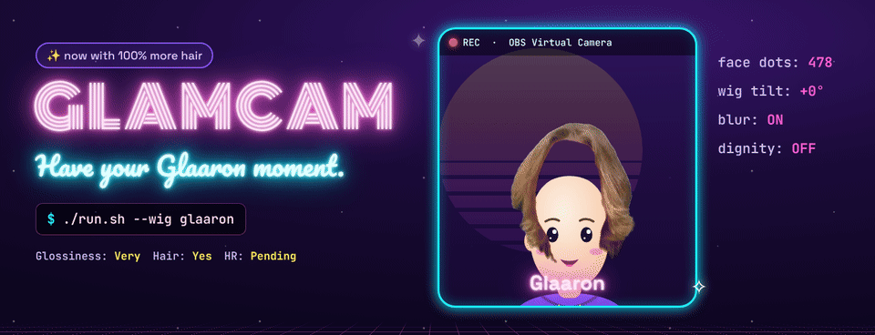
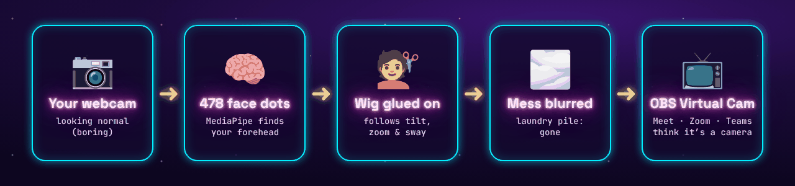
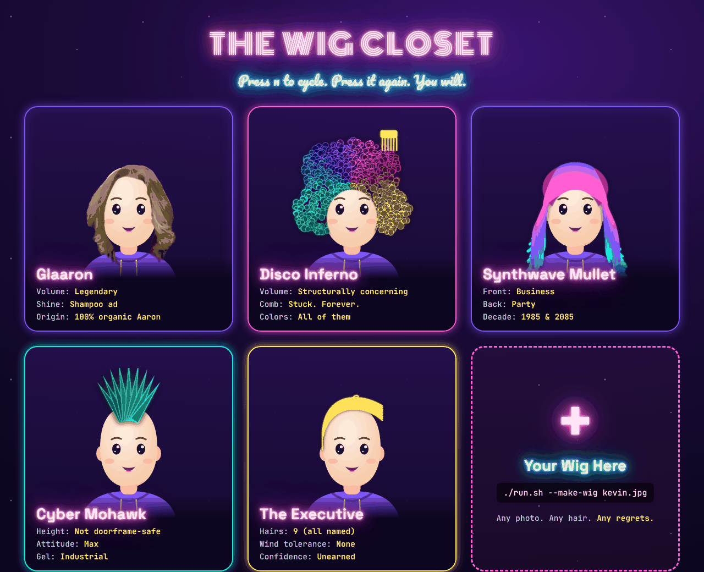
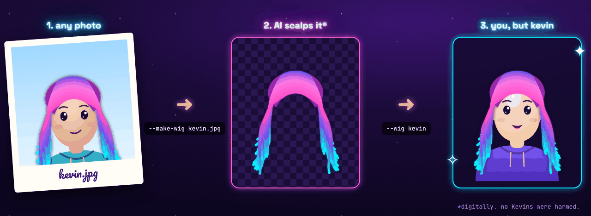

<p align="center">
  
</p>

<p align="center">
  <b>A face-tracking wig for your webcam.</b><br>
  For meetings that could have been an email, but now have <i>hair</i>.
</p>

<p align="center">
  
  
  
  
</p>

---

## What is this?

You know that one coworker with *the hair*? Flowing. Luminous. Shampoo-commercial-in-slow-motion hair?

**GlamCam lets you wear it to standup.**

It finds your face 30 times a second, glues a wig to your forehead (it follows you when you lean, tilt, nod, or dramatically turn away from a bad idea), blurs the pile of laundry behind you, and pipes the whole thing into Google Meet, Zoom, or Teams as a normal-looking camera.

Ships with **Glaaron**, the hair that started it all, plus four neon wigs nobody asked for. Or [make your own](#-make-your-own-wig) from any photo.

| | |
|---|---|
| **Glossiness** | Very |
| **Latency** | Smaller than your attention span in a 9am |
| **HR approved** | Pending |
| **Real hair harmed** | 0 |

## How it works

<p align="center"></p>

1. **MediaPipe** puts 478 dots on your face. GlamCam only listens to the forehead, brows, eyes and temples, so the wig doesn't flap when you talk.
2. The wig gets moved, scaled and rotated to match those dots, every frame.
3. A second model figures out which pixels are *you* and blurs everything else.
4. The result goes out through the **OBS Virtual Camera**, which every video app already knows how to use, either straight from GlamCam or via an OBS scene.

## The Wig Closet

<p align="center"></p>

| Wig | `--wig` | Vibe |
|---|---|---|
| Glaaron | `glaaron` | The original. The legend. Default. |
| Disco Inferno | `disco-inferno` | Has a comb in it. The comb lives there now. |
| Synthwave Mullet | `synthwave-mullet` | Business in the front, Miami Vice in the back. |
| Cyber Mohawk | `cyber-mohawk` | Do not attempt doorways. |
| The Executive | `the-executive` | Nine hairs. One dream. |

Press **`n`** while it's running to cycle through them.

---

## 🚀 Getting started

Three steps, about 10 minutes the first time:

1. **[Set up OBS](#step-1--set-up-obs-one-time)**: it provides the virtual camera Meet will see.
2. **Get GlamCam**: the **[app](#step-2a--the-glamcam-app-easiest)** (double-click, no Python) or **[from source](#step-2b--run-from-source)** (for tinkering).
3. **[Connect it to Meet](#step-3--get-it-into-google-meet)**.

### Step 1 · Set up OBS (one time)

GlamCam's video reaches Meet through the **OBS Virtual Camera**, so OBS needs to install that camera once.

**macOS**

1. Install OBS from [obsproject.com](https://obsproject.com), or with Homebrew:
   ```bash
   brew install --cask obs
   ```
   Keep **OBS.app** in your **Applications** folder. macOS won't install the camera from anywhere else.
2. Open OBS and click **Start Virtual Camera** (Controls panel, bottom right).
3. macOS says a system extension was blocked. Allow it: **System Settings → General → Login Items & Extensions → Camera Extensions → OBS on**. On macOS 13–14 it's **Privacy & Security → Allow**.
4. **Restart your Mac.** If OBS says *"Could not find the virtual camera system process"*, macOS hasn't loaded the camera yet. A restart (or log out and back in) fixes it.
5. Check it worked. This should print `[activated enabled]`:
   ```bash
   systemextensionsctl list | grep -i obs
   ```

**Windows**

1. Install OBS from [obsproject.com](https://obsproject.com), or:
   ```powershell
   winget install -e --id OBSProject.OBSStudio
   ```
2. Open OBS, click **Start Virtual Camera**, then **Stop Virtual Camera**. Done.

### Step 2a · The GlamCam app (easiest)

A real **GlamCam.app** / **GlamCam.exe**: double-click it and a window called **GlamCam** opens with your wig on. Close the window to quit.

**Get it** (pick one):

- **Download it.** Grab the zip for your system from [**Releases**](https://github.com/jdonohoo/glamcam/releases). Bleeding-edge builds from every push are in the [**Actions** tab](https://github.com/jdonohoo/glamcam/actions/workflows/build-apps.yml) → latest run → **Artifacts** (needs a GitHub login).
- **Build it yourself.** Clone the repo (see [Step 2b](#step-2b--run-from-source)), then run `./build_app.sh` on macOS or double-click `build_app.bat` on Windows. You get `dist/GlamCam.app` or `dist\GlamCam\GlamCam.exe`.

**Install it:**

- **macOS:** unzip and drag **GlamCam.app** into **Applications**. A *downloaded* app isn't signed by Apple, so the first open is blocked. Go to **System Settings → Privacy & Security** and click **Open Anyway**, or run:
  ```bash
  xattr -dr com.apple.quarantine /Applications/GlamCam.app
  ```
  An app you built yourself skips this.
- **Windows:** unzip anywhere and keep **GlamCam.exe inside its folder** (it needs the files next to it). Right-click → **Send to → Desktop (create shortcut)**. If SmartScreen says "Windows protected your PC", click **More info → Run anyway**.

**First launch:** allow the camera when asked. On macOS, GlamCam gets its own switch in **System Settings → Privacy & Security → Camera**.

**Your stuff:** wigs you make and saved fits live in `~/Library/Application Support/GlamCam` (macOS) or `%APPDATA%\GlamCam` (Windows), so they survive app updates.

Now go to [Step 3](#step-3--get-it-into-google-meet).

### Step 2b · Run from source

For hacking on GlamCam, or if you'd rather not run an unsigned app. Needs **Python 3.10–3.13**.

**macOS**

1. Install Python (needs [Homebrew](https://brew.sh)):
   ```bash
   brew install python@3.12
   ```
   macOS ships an ancient Python 3.9, and pyenv likes to hand you that one. `setup.sh` hunts down the Homebrew one for you.
2. Get the code and set it up. This makes a private `.venv`, installs everything, and downloads the AI models (~5 MB):
   ```bash
   git clone https://github.com/jdonohoo/glamcam.git
   ```
   ```bash
   cd glamcam && ./setup.sh
   ```
3. Run it **from Terminal or iTerm2 on the Mac itself**, not over SSH or from an SSH app like Termius. macOS won't give those camera access. The first time, macOS asks whether your terminal may use the camera: click **Allow**.
   ```bash
   ./run.sh --obs-window
   ```

**Windows**

1. Install Python, then open a **new** terminal:
   ```powershell
   winget install -e --id Python.Python.3.12
   ```
2. Get the code (or **Code → Download ZIP** on GitHub, then **Extract All**):
   ```powershell
   git clone https://github.com/jdonohoo/glamcam.git
   ```
3. Double-click **`setup.bat`** in the `glamcam` folder. If SmartScreen gets nervous, click **More info → Run anyway**. It's a text file that runs `pip install`. We promise. Look at it.
4. Run it:
   ```powershell
   .\run.bat --obs-window
   ```
   If the camera won't open: **Settings → Privacy & security → Camera →** turn on **Let desktop apps access your camera**.

Forgot `setup`? `run.sh` / `run.bat` notice and do it for you.

> **Mac Studio / Mac mini / desktop PCs** may have several cameras. If GlamCam grabs the wrong one (hi, iPhone Continuity Camera 👋), add `--camera 1`, then `--camera 2`, and so on.

### Step 3 · Get it into Google Meet

There are two routes. **Route A works everywhere and is what the app does by default.**

#### Route A: through OBS (recommended)

GlamCam shows your glamorous self in a window, OBS captures that window, and OBS's virtual camera sends it to Meet.

1. Start GlamCam: open the **app**, or `./run.sh --obs-window` / `.\run.bat --obs-window` from source. Leave the **GlamCam** window open. Other windows can cover it.
2. In OBS, add the window as a source:
   - **macOS:** Sources **+** → **Deprecated** → **Window Capture** → window **[GlamCam] GlamCam** (**[python] GlamCam** when running from source). Use this older source on purpose: the newer *macOS Screen Capture* forgets the window every time GlamCam restarts, while the old one finds it again by name. The first time, OBS needs **System Settings → Privacy & Security → Screen & System Audio Recording → OBS on** (then reopen OBS).
   - **Windows:** Sources **+** → **Window Capture** → **[GlamCam.exe]: GlamCam** (**[python.exe]: GlamCam** from source), and set **Window Match Priority** to **Window title must match**.
3. If the window's title bar shows up in OBS, hold **⌥** (**Alt** on Windows) and drag the source's top edge down to crop it off.
4. In OBS, click **Start Virtual Camera**.
5. In Meet: **⋮ → Settings → Video → Camera → OBS Virtual Camera**. Turn **off** Meet's own blur and effects (GlamCam already did that, and two blurs make a smudge).

The window is always called **GlamCam**, so you can quit and relaunch GlamCam and OBS picks it right back up. Bonus: you get OBS scenes, overlays and recording for free.

#### Route B: direct (no OBS window)

GlamCam sends straight into the OBS Virtual Camera itself. Fewer moving parts, but on some Macs the picture comes out black. If that happens, use Route A.

1. **Quit OBS** completely. Only one program can drive the virtual camera.
2. Start GlamCam: `./run.sh` / `.\run.bat` from source, or launch the app with `--vcam`:
   ```bash
   /Applications/GlamCam.app/Contents/MacOS/GlamCam --vcam
   ```
   The terminal should print `Broadcasting 1280x720 to: OBS Virtual Camera`.
3. In Meet: **⋮ → Settings → Video → Camera → OBS Virtual Camera**.

In this route the preview window is mirrored like a selfie camera. Meet still gets the un-mirrored version, same as any webcam.

**Test without Meet (macOS):** **QuickTime Player → File → New Movie Recording**, click the **⌄** next to the record button, and choose **OBS Virtual Camera**.

---

## 🎮 Controls

Click the **GlamCam** window first, then:

| Key | Does |
|---|---|
| `w` `a` `s` `d` | Nudge the wig up / left / down / right |
| `-` `=` | Shrink / grow the wig |
| `n` | Next wig |
| `h` | Wig off / on (for when your skip-level joins) |
| `b` | Background blur off / on |
| `l` | Lighting match: dim the wig to match your room (off by default, because a wig lit by its own personal sun is funnier) |
| `p` | Save this wig's fit, so it's remembered next time |
| `?` | Show the keys on screen for a few seconds |
| `q` / `Esc` / close the window | Quit, return to your natural, disappointing hair |

## 🧪 Make your own wig

<p align="center"></p>

Any photo with a face and some hair works. GlamCam finds the face, cuts out *only* the hair, and saves it as a wig. Then press `n` until you reach it, or start with `--wig kevin`.

From source, macOS:

```bash
./run.sh --make-wig ~/Pictures/kevin.jpg --name Kevin
```

From source, Windows:

```powershell
.\run.bat --make-wig C:\Users\you\Pictures\kevin.jpg --name Kevin
```

With the app, macOS:

```bash
/Applications/GlamCam.app/Contents/MacOS/GlamCam --make-wig ~/Pictures/kevin.jpg --name Kevin
```

With the app, Windows (from the folder with GlamCam.exe):

```powershell
.\GlamCam.exe --make-wig C:\Users\you\Pictures\kevin.jpg --name Kevin
```

**For the best wig:**

- A real photo beats a screenshot: phone camera, sent as the original file.
- Face the camera straight on, head level, hair clearly visible and not over the face.
- A plain background that contrasts with the hair, soft light from the front.
- Frame from mid-chest up so all the hair fits, with some room above the head.
- If it sits a bit off, nudge it with `w a s d` / `- =` and press `p` to save.

Wigs you make go in **`my-wigs/`** when running from source (it's **git-ignored**, so you can't accidentally publish Kevin), or the app's data folder (see [Step 2a](#step-2a--the-glamcam-app-easiest)). Only the hair is kept: the face and background are blanked out of the file entirely, not just made transparent.

> 💅 **Wig etiquette:** Hair is personal. Ask before you wear someone's. Glaaron is here with Aaron's full, enthusiastic blessing. Aaron is reportedly very excited.

Want to add a wig for everyone? Put `name.png` + `name.json` in `wigs/` and open a PR. The neon wigs are drawn in code in [`tools/draw_wigs.py`](tools/draw_wigs.py), if you want to make more.

## ⚙️ All the options

Pass these to `run.sh` / `run.bat`, or to the app's executable.

| Option | Does |
|---|---|
| `--wig NAME` | Start with this wig (default `glaaron`) |
| `--list-wigs` | Show every wig you've got |
| `--make-wig PHOTO` | Turn a photo into a wig (`--name` to name it) |
| `--obs-window` | Route A: clean, un-mirrored **GlamCam** window for OBS, no virtual camera. The app's default |
| `--vcam` | App only: Route B, send straight to the OBS Virtual Camera |
| `--no-vcam` | From source: just the mirrored preview, no virtual camera |
| `--camera N` | Use camera number N (default 0) |
| `--width` / `--height` / `--fps` | Camera resolution (default 1280×720 @ 30) |
| `--smooth 0.7` | Steadier wig, a bit more lag (0–0.9, default 0.5) |
| `--no-blur` | Start with background blur off |
| `--match-lighting` | Start with lighting match on |
| `--download-models` | Re-download the AI models (from source) |

## 🩹 Troubleshooting

**OBS: "Could not find the virtual camera system process"**
The camera extension is installed but macOS hasn't loaded it. Restart the Mac (or log out and back in). Then check `systemextensionsctl list | grep -i obs` shows `[activated enabled]`.

**"Virtual camera unavailable"** (Route B)
Do [Step 1](#step-1--set-up-obs-one-time). And make sure OBS isn't running its own virtual camera at the same time.

**Meet shows a black screen**
Route A: is **Start Virtual Camera** on in OBS, and does the OBS preview show you? Route B: quit OBS completely and restart GlamCam. If it's still black on a Mac, switch to Route A.

**The GlamCam window is black or missing in OBS**
On macOS use **Deprecated → Window Capture**, not *macOS Screen Capture* ([Route A](#route-a-through-obs-recommended)), and give OBS **Screen & System Audio Recording** permission. On Windows, set **Window Match Priority → Window title must match**. GlamCam must be running before OBS can show it.

**I added "OBS Virtual Camera" as a camera inside OBS and it's black**
That's OBS looking at its own output. Capture the **GlamCam** window instead ([Route A](#route-a-through-obs-recommended)).

**"OBS Virtual Camera" isn't in Meet's camera list**
Fully quit the browser (on Mac ⌘Q, not just closing the window) and reopen it.

**Could not open camera**
On a Mac, run it from **Terminal** or **iTerm2** on the Mac itself, or use the app. SSH sessions and SSH apps like Termius can't get camera permission (they never even show up in the Camera list). Make sure your terminal (or GlamCam) is switched on in **System Settings → Privacy & Security → Camera**, and if you just switched it on, quit the terminal (⌘Q) and reopen it. On Windows, check **Settings → Privacy & security → Camera**. Still stuck? Try `--camera 1` (or 2, 3…) and close other apps using the camera (Zoom, FaceTime, Photo Booth).

**macOS: "GlamCam can't be opened" / "Apple could not verify…"**
Downloaded apps aren't signed. **System Settings → Privacy & Security → Open Anyway**, or build it yourself with `./build_app.sh`.

**"GlamCam needs Python 3.10–3.13"** (from source)
macOS: `brew install python@3.12`, then `./setup.sh` again. Windows: `winget install -e --id Python.Python.3.12`, open a **new** terminal, then run `setup.bat` again.

**The wig jitters**
`--smooth 0.7`. Good lighting on your face helps a lot too. Trackers love a ring light.

**The wig vanished**
It hides when it can't see your face for a third of a second. Come back into frame, or check that `h` didn't get bumped.

**Turning my head sideways looks weird**
The wig follows sliding, tilting and leaning in or out, but it's a flat picture, so it doesn't rotate in 3D. Keep it facing the camera. Like a newscaster. A glamorous newscaster.

## 🛠️ Building the apps

- **Locally:** `./build_app.sh` (macOS, makes `dist/GlamCam.app`) or `build_app.bat` (Windows, makes `dist\GlamCam\`). Each one sets things up if needed, builds with PyInstaller from [`glamcam.spec`](glamcam.spec), and runs a self-test on the result. Builds are for the machine you're on: build the Mac app on a Mac and the Windows app on Windows.
- **On GitHub:** [`.github/workflows/build-apps.yml`](.github/workflows/build-apps.yml) builds and self-tests both apps on every push to `master` / `glamcam-v1`. To publish a release, push a version tag and the zips get attached to [Releases](https://github.com/jdonohoo/glamcam/releases) automatically:
  ```bash
  git tag v1.0.0 && git push origin v1.0.0
  ```

## Credits

- Face tracking and segmentation: [MediaPipe](https://ai.google.dev/edge/mediapipe) (Apache 2.0 models)
- App packaging: [PyInstaller](https://pyinstaller.org)
- Virtual camera: [pyvirtualcam](https://github.com/letmaik/pyvirtualcam) + [OBS Studio](https://obsproject.com)
- Glaaron: Aaron's hair, used with permission and deep admiration
- Aesthetic: lovingly inspired by [Charm](https://charm.land) ✨

MIT licensed. See [LICENSE](LICENSE).

<p align="center"><sub>bad hair days &gt; /dev/null™</sub></p>
